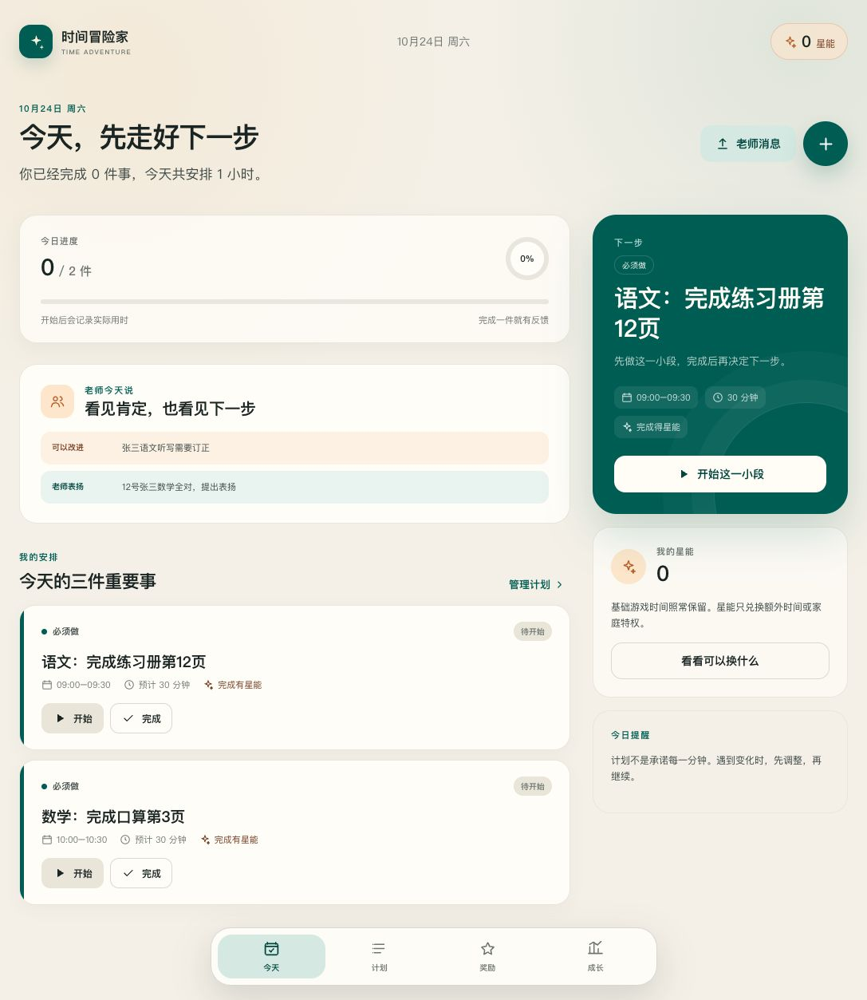
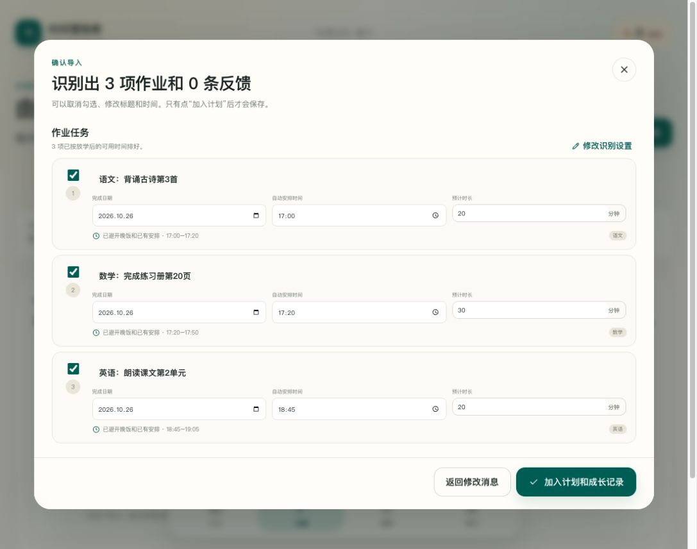
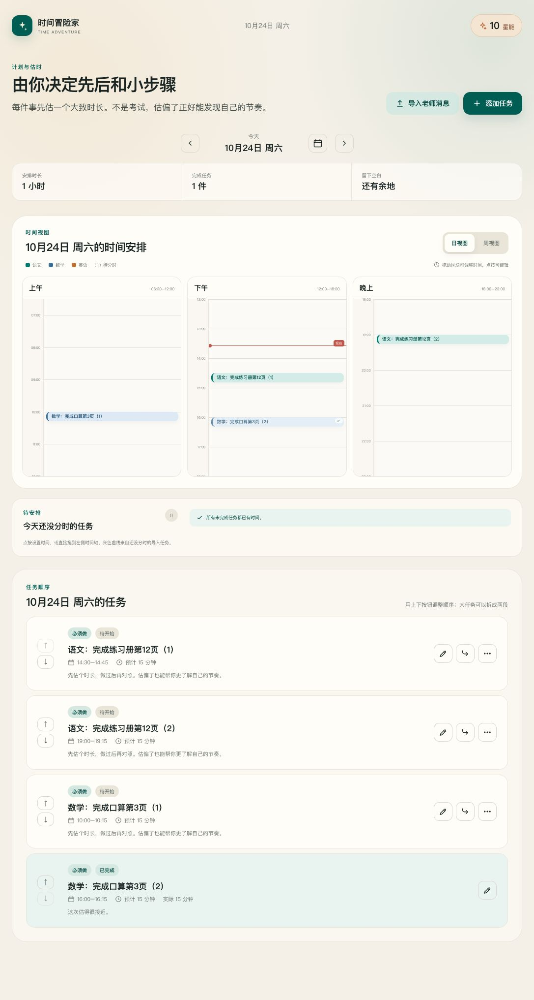
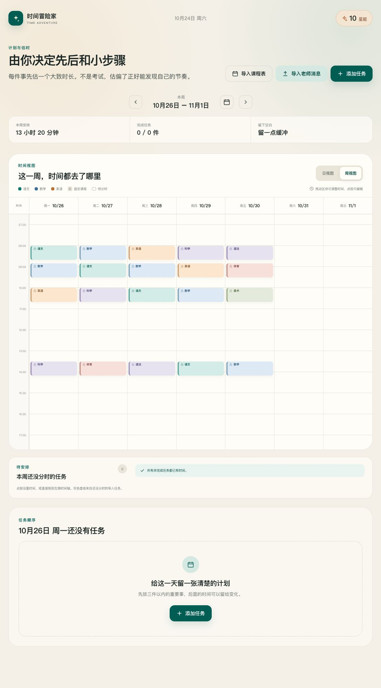
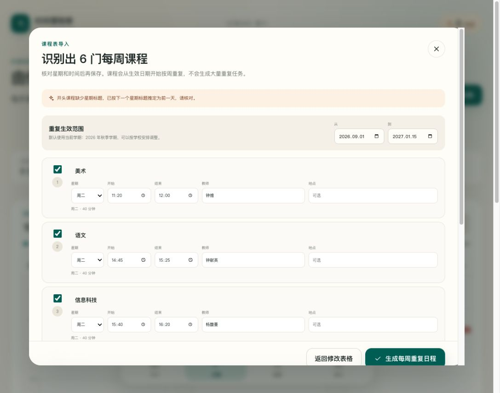

# 时间冒险家

一个运行在 iPad Safari 中的本地优先日程应用，帮助 11 至 12 岁的孩子完成“估时、开始、调整、复盘”的循环。首版不依赖账号、服务器或第三方脚本。











## 本地运行

需要 Node.js 和 Python 3。

```bash
cd /Users/huhu/Codex/kidsdaily/time-adventure
npm run dev
```

在 Mac 浏览器中打开 `http://127.0.0.1:4173`。停止时按 `Control-C`。

如果 iPad 与 Mac 连接到同一个 Wi-Fi，可以让 iPad 临时直接访问：

```bash
npm run dev:ipad
```

然后在 iPad Safari 中打开 `http://<Mac 的局域网 IP>:4173`。Mac 的 IP 可以在“系统设置 → Wi-Fi → 详细信息”中查看。这个方式适合 MVP 试用，但局域网 HTTP 不是安全上下文，离线缓存和完整的主屏幕 PWA 行为可能受限。需要长期给孩子使用时，应将项目部署到 HTTPS 地址。

### 脱离终端自动启动

macOS 可以安装用户级 LaunchAgent，让预览服务在登录 Mac 后自动运行，并在异常退出时重新启动：

```bash
cd /Users/huhu/Codex/kidsdaily/time-adventure
zsh deployment/install-macos-service.sh
```

安装后可直接访问 `http://<Mac 的主机名>.local:4173`，不需要保持 Codex 或 Terminal 打开。运行日志位于 `/tmp/time-adventure-server.log` 和 `/tmp/time-adventure-server.err.log`。

停止并移除自动启动服务：

```bash
zsh deployment/uninstall-macos-service.sh
```

## 测试

```bash
npm test
```

自动化测试覆盖星能账本、重复奖励防护、兑换上限、计时恢复、估时反馈和周报统计。浏览器交互还需要按照 `docs/ACCEPTANCE_TESTS.md` 在 Safari 与真实 iPad 上检查。

## 第一版范围

- 今日任务：添加、排序、开始、暂停、完成、拆分、改到明天和跳过。
- 今日科目筛选：自动按当天任务生成语文、数学、英语等筛选项，并显示每科任务数量。
- 手动任务优先：手动设置开始时间后，冲突中的其他任务会按顺序向后顺延。
- 一键清空：老师消息、课程表和添加任务对话框都可以快速清空大段内容。
- 到点提醒：App 打开时按任务开始时间弹出提醒并播放提示音，同一时间只提醒一次。
- 日历提醒：手动任务的“日历提醒”可生成带系统闹铃的 `.ics` 日历事件，网页关闭后由 iPad 日历提醒。
- 像素小恐龙：敲蛋三次后为小恐龙起名并孵化，可喂食、喂水、清理和抚摸。
- 宠物成长：连续未照料 3 天进入生病状态，可使用药品并开始恢复；6 天未有效照料后结束当前旅程并可重新领养。
- 宠物记录：照料日志、孵化日期和陪伴天数保存在本机，并包含在 JSON 备份中。
- 状态动画：口渴、饥饿、粪便未清理和生病分别播放独立像素帧序列。
- 体重成长：小恐龙出生约 3.2kg，显示大小从约 33% 开始，随陪伴和进食变大，12kg 封顶。
- 随机待机：健康时会自动踱步、挠头思考、睡觉或伸懒腰，让角色保持生动。
- 完整动画：使用透明图鉴中的真实六帧序列播放行走、自清理、摸头、睡觉、撒娇、玩耍、口渴、饥饿、脏乱和生病状态。
- 互动点：每完成一项计划任务获得 1 点；喂食、喂水、清理各消耗 1 点，抚摸免费，治疗消耗 2 点。
- 需求变化：每次喂食或喂水恢复 20%；饱腹和水分每过 24 小时衰减为前一天的一半。
- 生病风险：饱腹或水分低于 30% 会进入风险状态；单项持续偏低 12 小时，或两项同时偏低 6 小时会生病。
- 满值保护：饱腹、水分、清洁或心情达到 100% 时，对应互动按钮不可用，也不会扣除互动点。
- 可恢复计时：依据时间戳计算，关闭页面或锁屏后重新打开仍能继续。
- 星能账本：追加式记录，同一任务只发放一次奖励。
- 奖励兑换：申请、家长审批、拒绝退款、手动记录兑现。
- 晚间复盘：三个简短问题，默认只对自己可见。
- 成长页：近 7 天完成趋势、估时差异和主动调整统计。
- 老师消息导入：从粘贴的消息拆出作业任务，工作日避开晚饭自动排时，周末由孩子选择时间。
- 晚间回顾排程：工作日当天从设置的放学时间（默认 17:00）开始寻找空档，18:00–19:00 晚饭始终跳过。
- 科目标签：任务卡片、计划列表和时间轴显示科目，导入与手动任务都可以修改；旧任务会自动补全。
- 老师反馈：按自定义名字或学号筛选，识别并显示表扬/批评所属学科，记在当天且不改变星能余额。
- 奖励模块开关：家长区可随时开启或暂停奖励页，历史账本和兑换记录始终保留。
- 儿童主题：内置清爽、明亮、想象、自然、星际科技和霓虹电玩六套配色。
- 番茄式排程：连续专注 45–59 分钟后插入 10 分钟休息，达到 60 分钟后插入 15 分钟。

## 奖励模块开关

奖励模块首次使用时默认关闭。家长可以在“家长协作区”用开关随时启用或暂停：

- 关闭时，底部不显示“奖励”页，星能余额、任务奖励提示、兑换审批和奖励规则均会隐藏，任务完成与复盘不会继续累计新星能。
- 开启后，奖励入口、规则和兑换状态立即恢复，孩子完成任务后按家庭约定获得星能。
- 两种状态下都会保留已有账本和兑换历史，不会因关闭开关而删除或扣回。
- 日视图与周视图：按时间显示彩色任务区块，支持拖动改期、跨天安排和点按设时。
- 准时标记：完成时间不晚于计划结束时间时，任务块右上角显示“准时”。
- 待分时区：没有开始时间的导入任务显示为灰色虚线任务块，可直接拖到时间轴。
- 课程表导入：支持 XLSX、CSV、TSV 和 Excel 表格粘贴，确认后生成每周重复课程。
- 课程文本导入：支持 Markdown/列表式星期、节次、课程和教师内容，自动匹配秋季或春季学期范围。
- 固定课程：课程按星期自动出现在日、周视图，并在作业自动排程时作为不可占用时间。
- 家长区：本机 PIN、规则版本、待审批请求、共享复盘和 JSON 备份。
- PWA 外壳：可添加到 iPad 主屏幕，并在 HTTPS 部署后离线打开。

## 重要边界

浏览器中的 PIN 只能防止孩子误改约定，不是系统级安全。App 也不会自动控制或解锁 iPad 上的其他游戏。首版只负责记录兑换券与实际兑现状态，家长仍需使用 iPad 的“屏幕使用时间”手动兑现。

数据保存在当前浏览器的 IndexedDB 中。清理 Safari 网站数据会删除记录，家长应定期使用“导出备份”。直接双击 `index.html` 不能可靠加载 JavaScript 模块，请始终通过本地 HTTP 服务打开。
